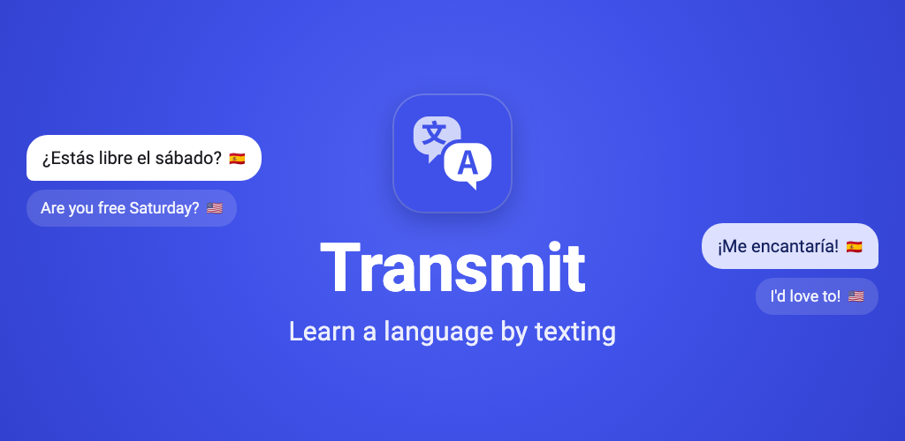
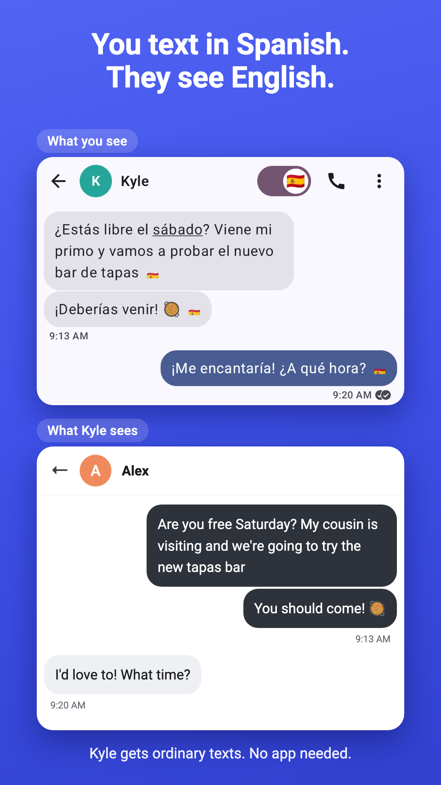
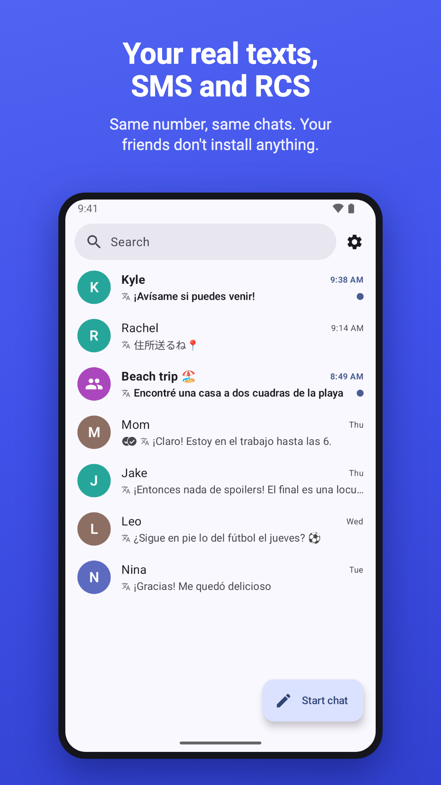
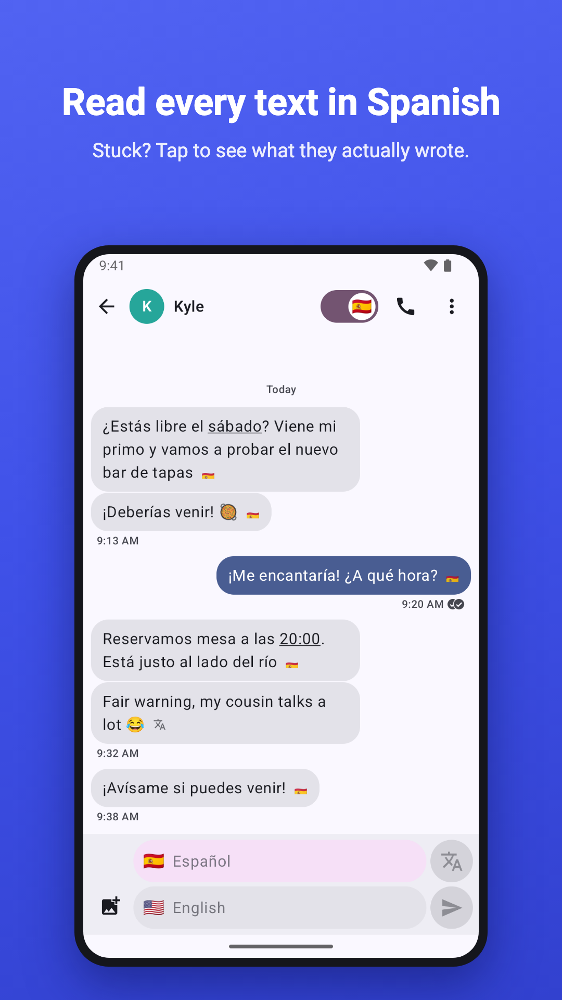
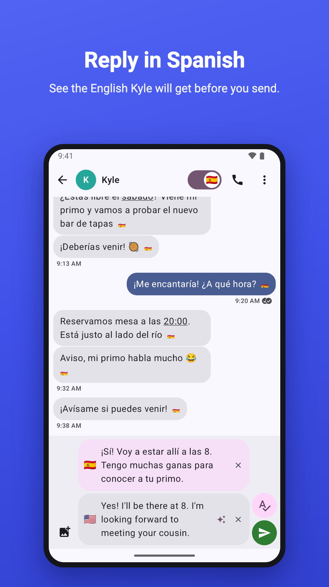
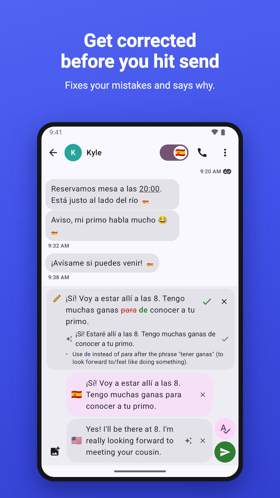
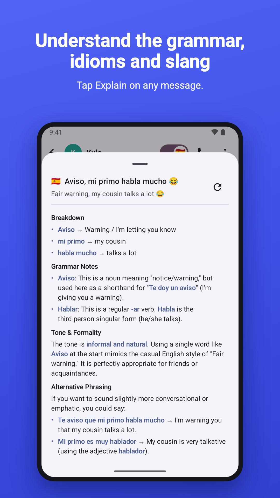
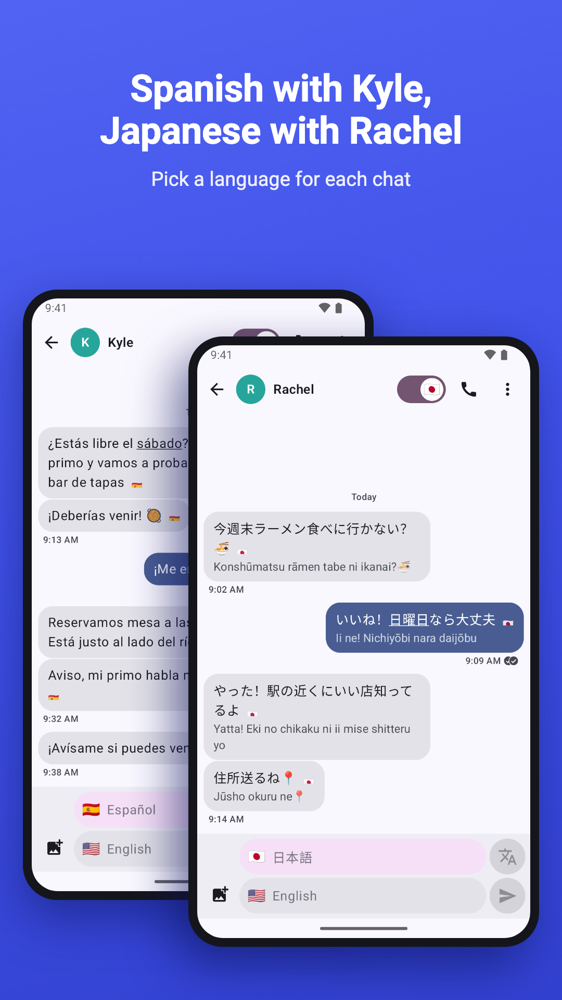

<p align="center">
  
</p>

<h1 align="center">Transmit: Learn by Texting</h1>

<p align="center">
  <b>Practice any language while texting your friends.</b><br>
  An Android app that works with Google Messages. Free week, then a monthly plan or your own AI key.
</p>

<p align="center">
  <a href="https://play.google.com/store/apps/details?id=com.ermay12.transmit"></a>
</p>

Transmit turns your everyday texting into language practice.

Learning a new language takes lots of natural input and supervised output practice, and finding chances to practice chatting is a major obstacle to fluency. With Transmit, every text you send and receive is practice.

**How it works:** your friends' SMS and RCS texts are automatically translated into the language you're learning. You reply in that language, and Transmit gives you feedback on your grammar and word choice. When you send, your message is translated back into your native language. Your friends just see normal texts, and they don't need to install anything.

## Screenshots

<p align="center">
  
  
  
  
  
  
  
</p>

## What you can do

- **Read every chat in your practice language.** New messages are translated as they arrive and stay hidden until they are, so you never read them in your own language first. Tap a message to see what your friend actually wrote.
- **Write in either language.** Write in your practice language and Transmit prepares the version your friend gets. Not sure how to say something? Write it in your own language and Transmit shows you how.
- **Check my translation.** Get your attempt graded before you send, with corrections, a more natural version and what changed.
- **Explain.** A phrase-by-phrase breakdown of any message, with notes on grammar, idioms and slang.
- **Chinese and Japanese.** Show pinyin or romaji under the characters, or on their own, and type in pinyin or romaji if you like.
- **A language per chat.** Practice Spanish with one friend and Japanese with another.
- **Your chats, as they are.** SMS, MMS and RCS, group chats, photos and videos, reactions, replies, read receipts, search, pin, mute and archive.
- **Little things.** Copy a verification code straight from the notification (codes are never sent for translation), share photos from any app to a recent chat, and tap addresses, dates, phone numbers and email addresses to open them in the right app.

## Free week and plans

- **Free week:** 7 days of translation and tutoring. No card needed, and it doesn't turn into a paid subscription.
- **Plans:** Transmit, or Transmit Plus with twice the AI, billed monthly through Google Play until you cancel.
- **Your own key:** prefer your own AI provider? Use an API key from Anthropic, OpenAI, Google Gemini, OpenRouter or any OpenAI-compatible service, and pay them directly (Settings → Advanced).
- Without a plan or key, Transmit still works for texting, with translation off.

## What you need

- An Android phone with **Google Messages** as its texting app. Transmit runs on Android 12 or later, on that phone or on another device.
- Transmit connects to Google Messages the same way Messages for Web does. Google Messages allows one web session at a time, so connecting Transmit signs out Messages for Web elsewhere, and the reverse.
- An internet connection for translation and the tutor.

Want to look around first? On the "Connect your messages" step of setup, long-press the heading to open a demo with sample chats.

## Privacy

Your messages never reach Transmit's server. To translate, the message and a few earlier messages from the same chat are sent to an AI service: with the free week or a plan, OpenRouter, limited to hosts with zero-data-retention policies; with your own key, the provider you chose. The AI never sees contact names, your name or phone numbers: people in a chat are "Me" and "Them". No ads, no analytics. Details are in the [privacy policy](https://transmit.ermay12.workers.dev/privacy).

## Good to know

- AI translations can be wrong. Check anything important with the person you're texting.
- Transmit is an independent app. It isn't made, endorsed or supported by Google. It uses the same unofficial connection as Messages for Web, so a change on Google's side can stop it working until Transmit is updated.
- Google Messages is a trademark of Google LLC.

## Install

- **[Google Play](https://play.google.com/store/apps/details?id=com.ermay12.transmit)** (recommended): updates automatically, and the only way to get the free week and plans.
- **APK from [Releases](https://github.com/ermay12/transmit/releases/latest)**, for phones without Google Play. It works with your own AI key only, and it can't update a Play install or be updated by one, since the two are signed differently. To switch, uninstall first.

Found a bug or have an idea? [Open an issue](https://github.com/ermay12/transmit/issues).

---

## For developers

Transmit is a Kotlin app with Jetpack Compose. Its Google Messages layer is a Kotlin port of libgm from [mautrix-gmessages](https://github.com/mautrix/gmessages). Subscriptions and the free week go through a small Cloudflare Worker in [`backend/`](backend/README.md), which checks Google Play and issues per-user OpenRouter keys. Messages never pass through it.

### Build

You need JDK 17 or later and the Android SDK (compile SDK 36).

```sh
./gradlew :app:assembleRelease
adb install -r app/build/outputs/apk/release/app-release.apk
```

```sh
./gradlew :app:testDebugUnitTest   # unit tests
```

- **Signing:** release builds are signed with your debug key, so they install directly. To build a bundle for Google Play, set `TRANSMIT_UPLOAD_KEYSTORE` (a PKCS12 keystore with the alias `upload`) and `TRANSMIT_UPLOAD_PASSWORD`, then run `./gradlew :app:bundleRelease`.
- **Versions:** the version code is the number of commits, so each newer build installs as an update.
- **Releases:** every push to `main` runs the unit tests and builds a release APK with GitHub Actions ([`release.yml`](.github/workflows/release.yml)). When `versionName` changes, it publishes the APK as a new release, signed with the key in the `DEBUG_KEYSTORE_BASE64` secret.
- **Own-key mode only:** a build that isn't installed from Google Play can't start the free week or subscribe.

### Project layout

```
app/src/main/java/app/transmit/
  gm/          Google Messages protocol: pairing, encryption, long polling, sync, media, the bridge service
  messaging/   conversations and messages read from the cache, sending, reactions
  ai/          provider clients, prompts, translation manager, tutor, budgets, pricing
  access/      AI access modes: free week, Play subscriptions, own key, and the Worker that issues managed keys
  data/        Room database, settings (DataStore), contacts, encrypted key store
  notify/      incoming-message worker (background translation) and notifications
  smart/       on-device detection of verification codes, dates, addresses, phones and emails
  demo/        the demo's sample chats, kept in memory
  ui/          Jetpack Compose screens: home, chat, new chat, pairing, settings, plans, onboarding
backend/       the Cloudflare Worker: free week, Play subscriptions, managed keys, privacy and terms pages
docs/          product notes and launch material (store listing, privacy policy, data safety)
```

Google Messages on the phone is the source of truth for messages. Transmit's Room database (schemas in `app/schemas/`) caches its conversations and messages (`gm_*` tables) and holds translations, drafts, per-chat settings and the usage ledger. Dependencies are wired by hand in `AppContainer`. API keys are encrypted with an Android Keystore key.

## License

Transmit is licensed under the [GNU Affero General Public License, version 3](LICENSE). Its Google Messages layer (`app/src/main/java/app/transmit/gm` and `app/src/main/proto/gm`) is a Kotlin port of libgm from [mautrix-gmessages](https://github.com/mautrix/gmessages), which is licensed under the same terms.
